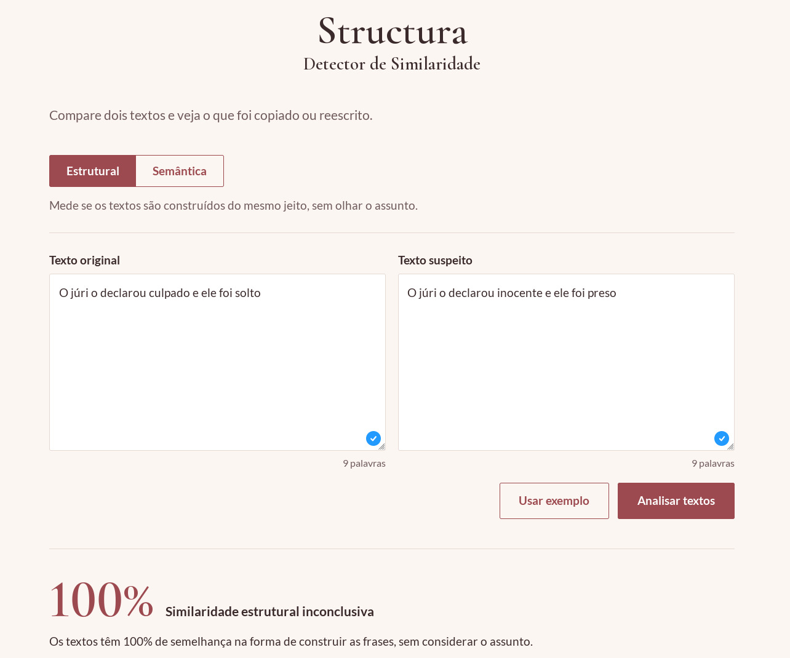
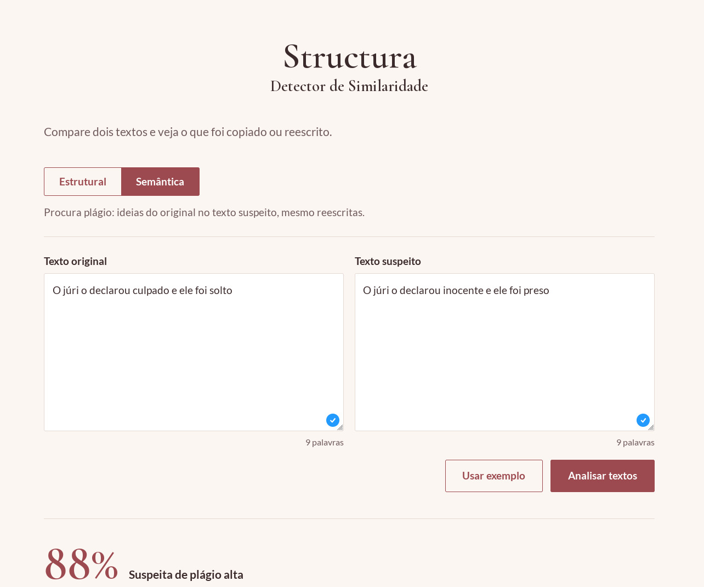
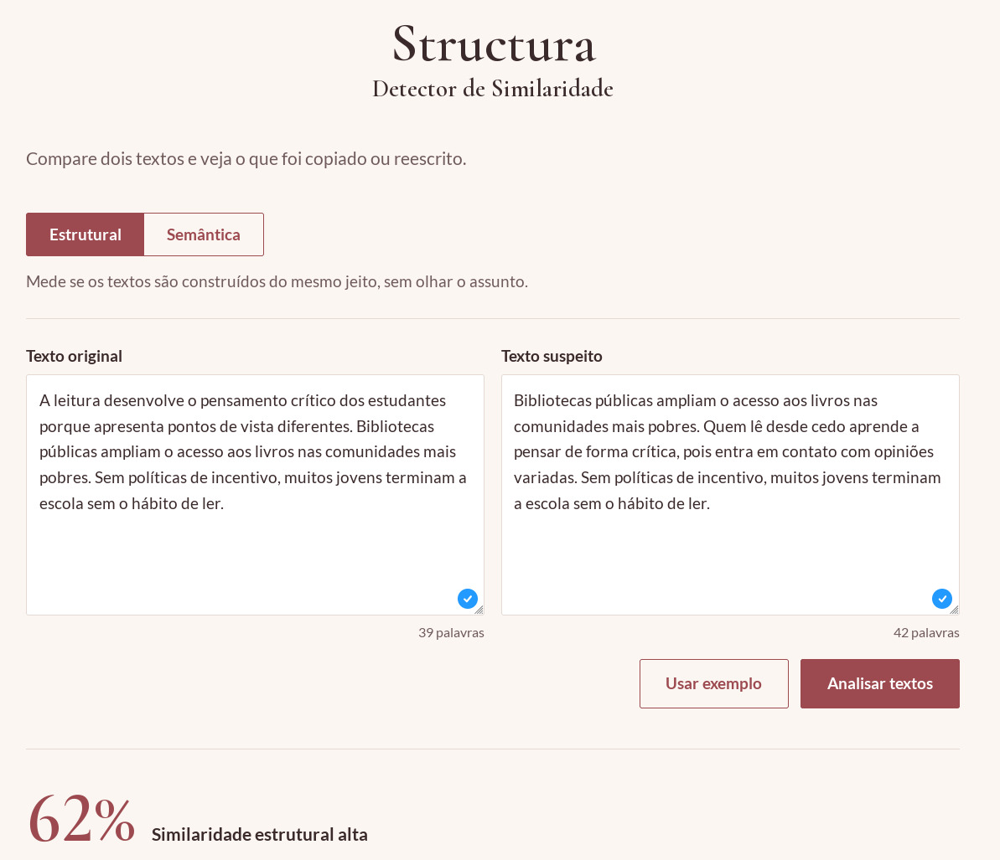
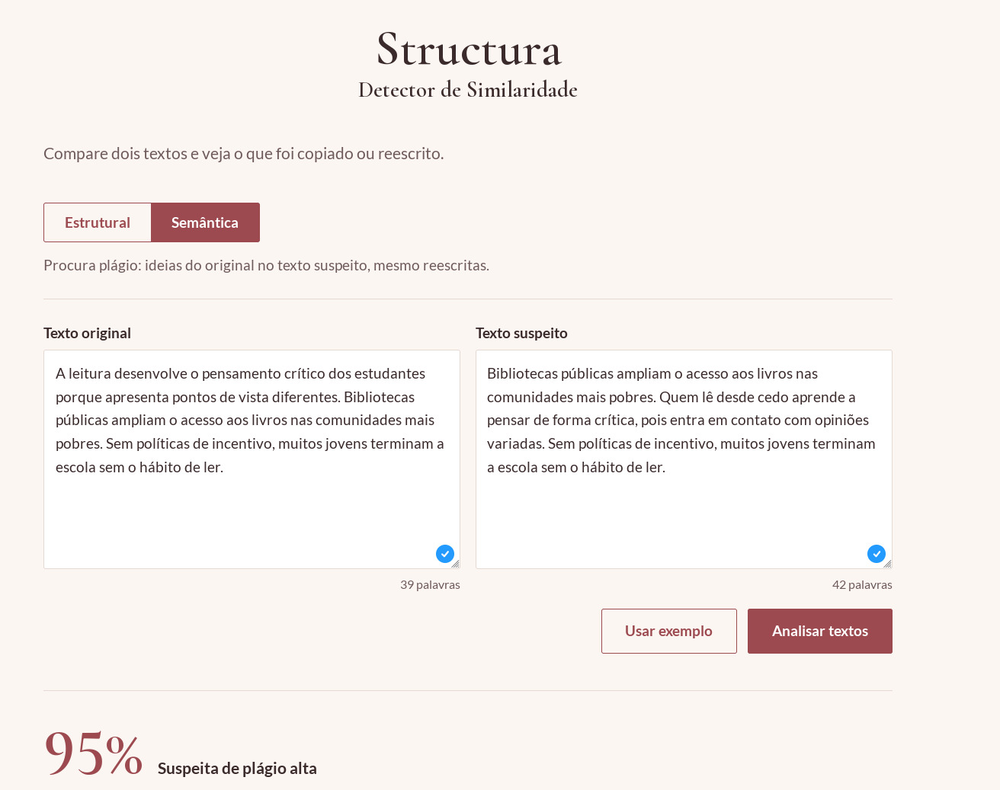
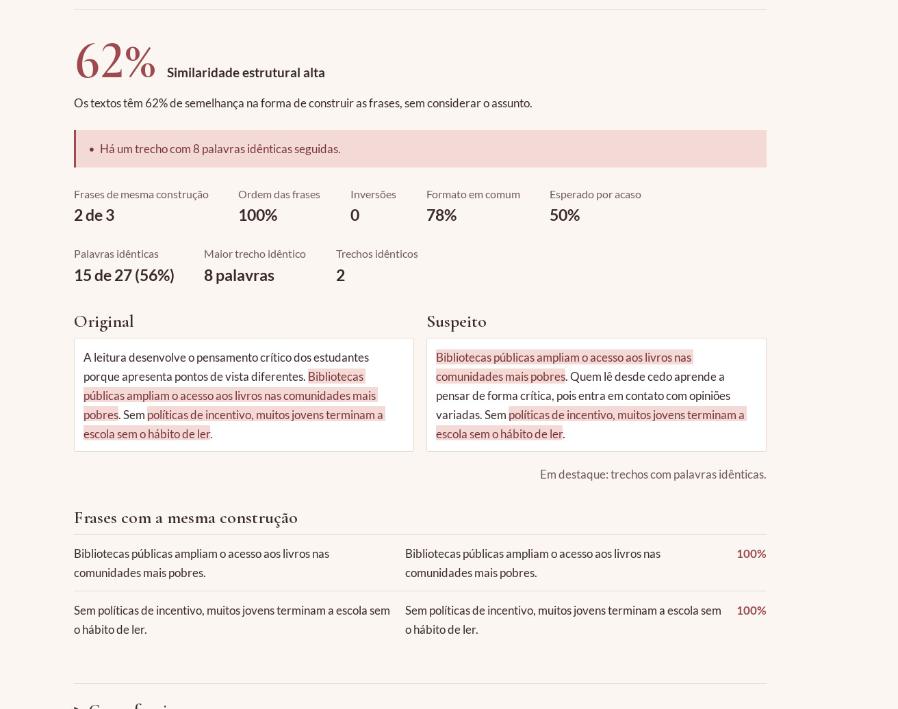
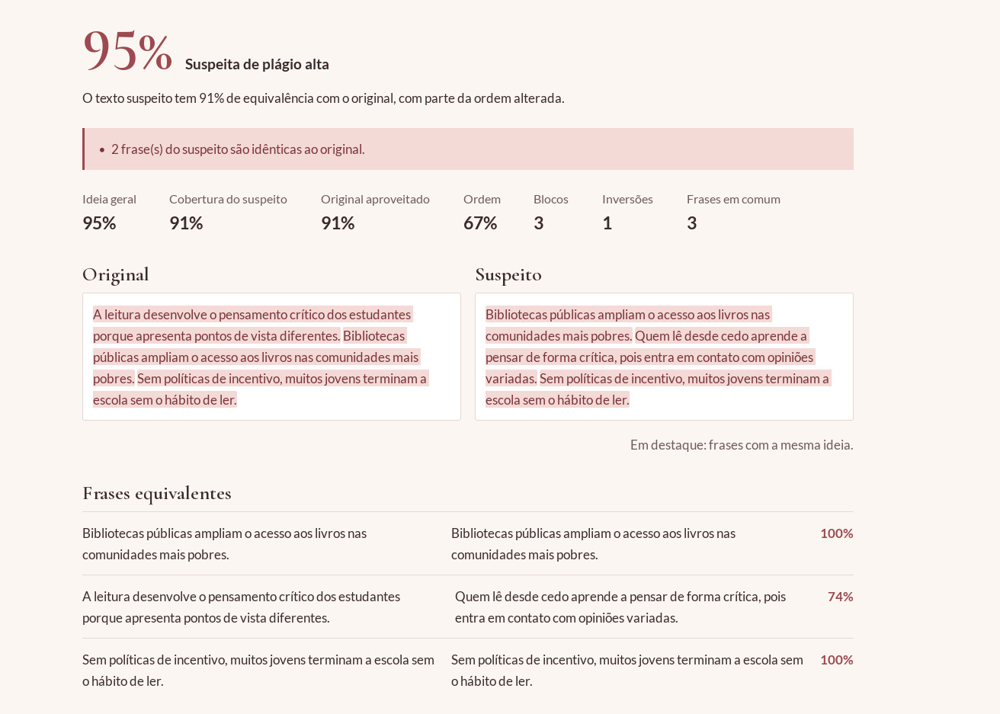
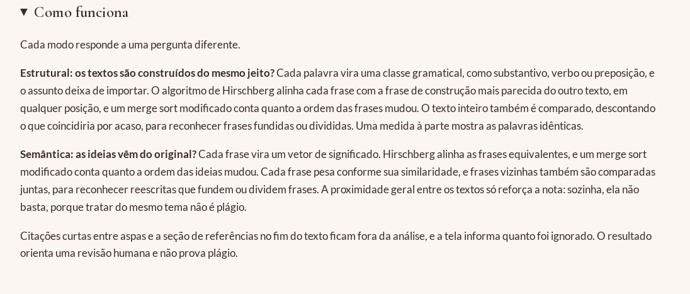

<h1><font size="6"><b>Structura</b></font><br></h1>
<h3><b>Número da Lista:</b> 17<br></h3>
<h3><i>Conteúdo da disciplina:</i> Dividir e Conquistar<br></h3>
<h3>Alunos</h3>

| Matrícula | Aluno |
|-----------|----------------------------------|
| 251013660 | Matheus Moretti Soares           |
| 251019771 | Daniel Filipe Borges de Oliveira |

---

## Sobre
O **Structura** é uma ferramenta web que atua como **Detector de Similaridade** apontando indícios de plágio entre dois textos, em dois modos:

- **Estrutural:** as frases foram construídas do mesmo jeito? Olha a classe gramatical das palavras, não o assunto.
- **Semântica:** as ideias vêm do original? Reconhece cópias reescritas com outras palavras.

Os dois modos usam **Hirschberg** para alinhar as frases e **Counting Inversions (Merge Sort modificado)** para medir o quanto a ordem mudou. O resultado orienta uma revisão humana e não prova plágio.

## Screenshots
<table align="center">
  <!-- LINHA 1 -->
  <tr>
    <td align="center">
      <b>1. Teste Estrutural 100%</b><br>
      
    </td>
    <td align="center">
      <b>2. Teste de Inversão de Sentido </b><br>
      
    </td>
  </tr>
  
  <!-- LINHA 2 -->
  <tr>
    <td align="center">
      <b>3. Teste Estrutural(Botão Usar Exemplo)</b><br>
      
    </td>
    <td align="center">
      <b>4. Teste Semântico(Botão Usar Exemplo)</b><br>
      
    </td>
  </tr>
  
  <!-- LINHA 3 -->
  <tr>
    <td align="center">
      <b>5. Resultado Teste Estrutural</b><br>
      
    </td>
    <td align="center">
      <b>6. Resultado Teste Semântico</b><br>
      
    </td>
  </tr>
</table>

<div align="center">
  <br>
  <b>7. Como funciona?</b><br>
  
</div>

## Instalação

**Linguagens:** Python e JavaScript · **Framework:** FastAPI · **Pré-requisitos:** Python 3.12+ e Git

```bash
git clone https://github.com/projeto-de-algoritmos-2026/G17_Dividir_e_Conquistar_PA-26.2_Structura.git
```

```bash
cd G17_Dividir_e_Conquistar_PA-26.2_Structura
```

```bash
python -m venv venv
```

```bash
# Linux source venv/bin/activate        # Windows: venv\Scripts\activate
```

```bash
pip install -r backend/requirements.txt
```

## Uso
```bash
uvicorn backend.main:app --reload
```

Acesse http://localhost:8000. O front é servido pelo backend, então abrir o `index.html` direto não funciona.

A primeira análise semântica baixa o modelo de linguagem e precisa de internet. As seguintes funcionam offline.

## Testes
```bash
pip install -r backend/requirements-dev.txt
python -m pytest
```

## Outros
- [Infraestrutura](docs/infraestrutura.md): arquitetura, algoritmos, fórmulas, limites e testes.
- [Guia da apresentação](docs/guia-apresentacao.md): roteiro, explicações e perguntas prováveis.

# Vídeo de apresentação
[Link do Vídeo Gravado no Teams](https://unbbr-my.sharepoint.com/:v:/g/personal/251013660_aluno_unb_br/IQAWKwezYUkmSZr3PW7j7-NpAd3w8Fq6YUn33HdPJgA09sM)